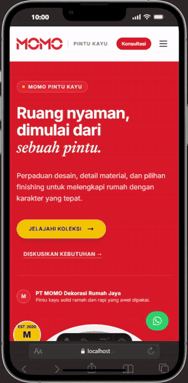

# MOMO Pintu Kayu — Landing Page

Landing page katalog produk untuk **MOMO Pintu Kayu / PT MOMO Dekorasi Rumah Jaya**. Website ini dibuat untuk menampilkan koleksi model pintu, pilihan finishing, informasi material, keunggulan produk, FAQ, serta akses konsultasi langsung melalui WhatsApp.

Project dikembangkan menggunakan **Astro, React, Tailwind CSS, dan TypeScript**, dengan bantuan **Google Antigravity** selama proses penulisan dan penyempurnaan kode.

> Website ini merupakan landing page frontend. Pada versi saat ini, katalog produk disimpan sebagai data lokal dan belum menggunakan backend, database, CMS, atau sistem admin.



- [Tonton rekaman preview lengkap (MP4)](docs/demo-preview.mp4)
- Rekaman ini merupakan demo tampilan mobile

## Tech Stack

| Teknologi | Penggunaan dalam project |
|---|---|
| [Astro](https://astro.build/) | Framework utama untuk menyusun halaman dan komponen `.astro`, routing halaman, serta menghasilkan website statis. |
| [React](https://react.dev/) | Menangani bagian yang interaktif, seperti navigasi mobile, katalog produk, modal detail produk, dan FAQ accordion. |
| [TypeScript](https://www.typescriptlang.org/) | Menulis data model, helper WhatsApp, serta komponen React dengan tipe data. |
| [Tailwind CSS v4](https://tailwindcss.com/) | Styling menggunakan utility classes dan design tokens khusus MOMO. |
| [Vite](https://vite.dev/) | Development server dan tooling frontend yang dikonfigurasi melalui Astro. |
| Google Fonts | Memuat font **Inter** untuk teks antarmuka dan **Newsreader** untuk aksen editorial. |
| WhatsApp Click to Chat | Mengarahkan calon pelanggan ke konsultasi WhatsApp dengan pesan yang sudah disiapkan. |
| [Google Antigravity](https://antigravity.google/) | Lingkungan pengembangan berbantuan AI yang digunakan selama proses pembuatan dan penyempurnaan project; bukan dependency runtime website. |

### Paket utama dari `package.json`

- `astro`
- `@astrojs/react`
- `react` dan `react-dom`
- `tailwindcss` dan `@tailwindcss/vite`
- `vite`
- `typescript` melalui file `.ts` / `.tsx` dan konfigurasi TypeScript Astro

Project juga memiliki dependency `@astrojs/mdx` dan `canvas-confetti`. Integrasi MDX belum diaktifkan di `astro.config.mjs`; komponen `Button.astro` yang memuat `canvas-confetti` tersedia sebagai komponen tambahan dan tidak diimpor oleh halaman utama saat ini.

## Fitur

- **Responsive layout** untuk desktop dan mobile.
- **Top announcement bar** dengan slogan MOMO dan tautan ke bagian kontak.
- **Sticky navbar** dengan menu desktop dan hamburger menu untuk mobile.
- **Hero section** menggunakan foto interior dari aset katalog, headline, serta CTA menuju koleksi dan konsultasi.
- **Fact strip** untuk menonjolkan informasi utama yang ditampilkan pada halaman.
- **Katalog model pintu interaktif** dengan filter `Semua model`, `Carbon`, `Panel`, dan `Klasik`.
- **Pencarian katalog** berdasarkan kode atau nama model.
- **Tampilkan/sembunyikan koleksi**: katalog menampilkan sebagian item terlebih dahulu dan dapat diperluas.
- **Modal detail produk** untuk melihat informasi dan gambar model yang dipilih.
- **Tautan WhatsApp per model** yang membuat pesan konsultasi berdasarkan kode produk.
- **Finishing palette** berisi lima finishing bernama yang mengikuti katalog MOMO.
- **Bagian keunggulan dan material** untuk menyampaikan informasi produk yang tersedia dalam materi katalog.
- **Langkah konsultasi** untuk membantu pelanggan memahami alur menghubungi MOMO.
- **FAQ accordion** untuk pertanyaan umum.
- **CTA penutup, footer kontak, dan tombol WhatsApp mengambang**.
- **Metadata dasar SEO** berupa judul halaman, meta description, Open Graph, bahasa Indonesia, dan favicon.
- **Aset gambar lokal** di folder `public/images/momo/`, sehingga gambar produk tidak bergantung pada image URL dari layanan eksternal.

## Design System

Warna utama didefinisikan di `src/styles/global.css` menggunakan `@theme` dari Tailwind CSS v4.

| Token | Hex | Penggunaan |
|---|---|---|
| `momo-red` | `#D91A2A` | Warna utama brand, hero, dan CTA tertentu |
| `momo-darkred` | `#BE1422` | Aksen merah gelap |
| `momo-softred` | `#FAF1F2` | Latar merah lembut |
| `momo-yellow` | `#F5C400` | Aksen kuning dan tombol utama di hero |
| `momo-yellowHover` | `#E5B700` | Warna hover kuning |
| `momo-dark` | `#161616` | Latar gelap, announcement bar, dan footer |
| `momo-charcoal` | `#222222` | Warna charcoal |
| `momo-cream` | `#FBF9F5` | Latar section katalog dan proses konsultasi |
| `momo-border` | `#E8E5DF` | Border netral |

**Font:** Inter untuk teks utama dan Newsreader italic untuk headline editorial. Keduanya dimuat dari Google Fonts pada layout utama.

## Aset Katalog

Aset disimpan di `public/images/momo/` dan bersumber dari katalog PDF MOMO yang digunakan selama pembuatan website.

```text
public/
├── favicon.ico
├── favicon.svg
└── images/
    └── momo/
        ├── catalog/    # gambar referensi cover katalog
        ├── extras/     # QR katalog dan gambar referensi keunggulan
        ├── finishes/   # tekstur finishing dan swatch referensi
        ├── hero/       # foto interior untuk hero
        ├── logo/       # logo MOMO merah dan putih
        └── models/     # gambar model pintu
```

- Folder `models` berisi **38 gambar model pintu**: gambar model berlabel, dua varian visual Model R-025, serta beberapa desain yang tidak diberi kode pada sumber katalog.
- `src/data/momo-products.ts` saat ini berisi **32 entri katalog**: 18 kategori Carbon, 6 Panel, dan 8 Klasik. Model R-025 ditampilkan sebagai dua varian visual, sehingga jumlah entri tidak sama dengan jumlah kode model unik.
- Folder `finishes` berisi 15 gambar: lima swatch dengan nama finishing dan sepuluh swatch tambahan yang ditampilkan sebagai referensi bernomor dari sampul katalog.
- Logo MOMO merah dan putih berada di `logo/`; foto interior hero berada di `hero/`.

Gambar adalah referensi visual dari katalog. Konfirmasi warna finishing, spesifikasi, harga, ketersediaan, dimensi, serta garansi kepada pihak MOMO sebelum menjadikannya informasi final untuk transaksi.

## Struktur Source Code

```text
src/
├── components/
│   ├── BenefitsSection.astro
│   ├── Button.astro
│   ├── ClosingCTA.astro
│   ├── ConsultationSteps.astro
│   ├── FAQAccordion.tsx
│   ├── FactStrip.astro
│   ├── FinishingPalette.astro
│   ├── FloatingWhatsApp.astro
│   ├── Footer.astro
│   ├── HeroSection.astro
│   ├── MaterialDetails.astro
│   ├── Navbar.tsx
│   ├── ProductCatalog.tsx
│   └── TopAnnouncement.astro
├── data/
│   └── momo-products.ts
├── layouts/
│   ├── Layout.astro
│   └── main.astro
├── pages/
│   ├── index.astro
│   └── markdown-page.md
├── styles/
│   └── global.css
└── utils/
    └── whatsapp.ts

public/
└── images/momo/...

astro.config.mjs
package.json
package-lock.json
tsconfig.json
```

### Pola rendering interaktif

Astro digunakan untuk merangkai halaman dan komponen yang mayoritas bersifat statis. Komponen React dihidrasikan hanya ketika diperlukan:

- `Navbar` menggunakan `client:load` untuk menu mobile.
- `ProductCatalog` menggunakan `client:load` karena filter, pencarian, expand katalog, dan modal membutuhkan interaksi.
- `FAQAccordion` menggunakan `client:visible` agar interaktivitas dimuat ketika komponen mendekati viewport.

Pendekatan ini menjaga halaman tetap berbasis Astro tanpa menjadikan seluruh website sebagai aplikasi React client-side.

## Menjalankan Project Secara Lokal

### Prasyarat

- Node.js **`>=22.22.0`**, sesuai `engines` di `package.json`.
- npm.
- Git (opsional untuk menjalankan project secara lokal, diperlukan jika akan dikelola melalui repository GitHub).

### Instalasi

Clone repository:

```bash
git clone <URL-REPOSITORY-GITHUB>
cd landing-page
```

Install dependency:

```bash
npm install
```

Jalankan development server:

```bash
npm run dev
```

Buka alamat yang ditampilkan di terminal, biasanya:

```text
http://localhost:4321
```

### Perintah tersedia

| Perintah | Fungsi |
|---|---|
| `npm run dev` | Menjalankan development server Astro |
| `npm run build` | Membuat build production ke folder `dist/` |
| `npm run preview` | Melihat hasil build secara lokal |
| `npm run astro` | Menjalankan Astro CLI |

## Deployment

Project ini dikonfigurasi sebagai landing page statis dan dapat dideploy ke layanan static hosting seperti **Vercel** atau **Netlify**.

Pengaturan build yang digunakan:

- **Framework:** Astro
- **Build command:** `npm run build`
- **Output directory:** `dist`
- **Environment variables:** tidak diperlukan untuk fitur yang ada saat ini

Alur deployment yang disarankan:

1. Push source code ke repository GitHub.
2. Import repository tersebut di Vercel atau Netlify.
3. Pastikan build command `npm run build` dan output directory `dist`.
4. Jalankan deployment dan periksa seluruh gambar serta tautan WhatsApp pada URL publik.

Folder `dist/` adalah hasil build, bukan tempat utama mengedit source. Pada repository, pertahankan source di `src/`, aset di `public/`, serta `package.json` dan `package-lock.json`; layanan hosting akan membuat hasil build dari source tersebut.

### Preview lokal via Cloudflare Quick Tunnel

Cloudflare Quick Tunnel pernah digunakan untuk membagikan development preview kepada klien tanpa hosting. Fitur ini hanya untuk preview sementara dan bukan bagian dari kebutuhan production.

**Sebelum mengunggah project ke GitHub atau melakukan deployment, periksa `astro.config.mjs`.** File saat ini memiliki hostname Quick Tunnel sementara di `vite.server.allowedHosts`. Hostname tersebut akan berubah jika tunnel dibuat ulang. Hapus konfigurasi preview sementara jika tidak lagi dibutuhkan, atau ubah hanya untuk kebutuhan development. Jangan mengandalkan hostname `trycloudflare.com` sebagai alamat website permanen.

## WhatsApp

Tautan WhatsApp dibangun melalui helper di `src/utils/whatsapp.ts`. Nomor kontak saat ini ditulis di konstanta `MOMO_PHONE_NUMBER` dan pesan dapat diisi otomatis sesuai konteks konsultasi maupun kode model.

Jika nomor kontak bisnis berubah, perbarui `MOMO_PHONE_NUMBER` dan `MOMO_DISPLAY_PHONE` pada file tersebut, lalu uji semua tombol konsultasi.

## Batasan Versi Saat Ini

- Belum ada backend, database, autentikasi, dashboard admin, atau CMS.
- Data katalog berada di `src/data/momo-products.ts` dan perlu diperbarui manual jika ada perubahan produk.
- Harga dan ketersediaan tidak diambil dari sistem transaksi; pelanggan diarahkan untuk bertanya melalui WhatsApp.
- Tidak ada integrasi pembayaran online pada versi ini.
- Data kontak dan sebagian konten bisnis ditulis langsung di source code.

## Pengembangan Berikutnya

Ide pengembangan yang dapat dipertimbangkan jika kebutuhan bisnis bertambah:

- Menambahkan screenshot desktop dan mobile ke dokumentasi repository.
- Memisahkan konfigurasi kontak bisnis ke environment variable jika diperlukan.
- Menambahkan CMS atau sumber data katalog agar produk lebih mudah diperbarui.
- Menambahkan analytics setelah menyepakati kebutuhan privasi dan pelacakan.
- Mengintegrasikan CRM atau sistem stok jika memang dibutuhkan oleh operasional MOMO.

## Kredit dan Sumber Aset

- **Brand dan konten produk:** MOMO Pintu Kayu / PT MOMO Dekorasi Rumah Jaya.
- **Sumber gambar katalog:** PDF katalog MOMO yang disediakan untuk pembuatan project ini.
- **Pengembangan:** Google Antigravity digunakan sebagai lingkungan kerja berbantuan AI; teknologi yang dijalankan website tetap tercantum pada bagian Tech Stack.


